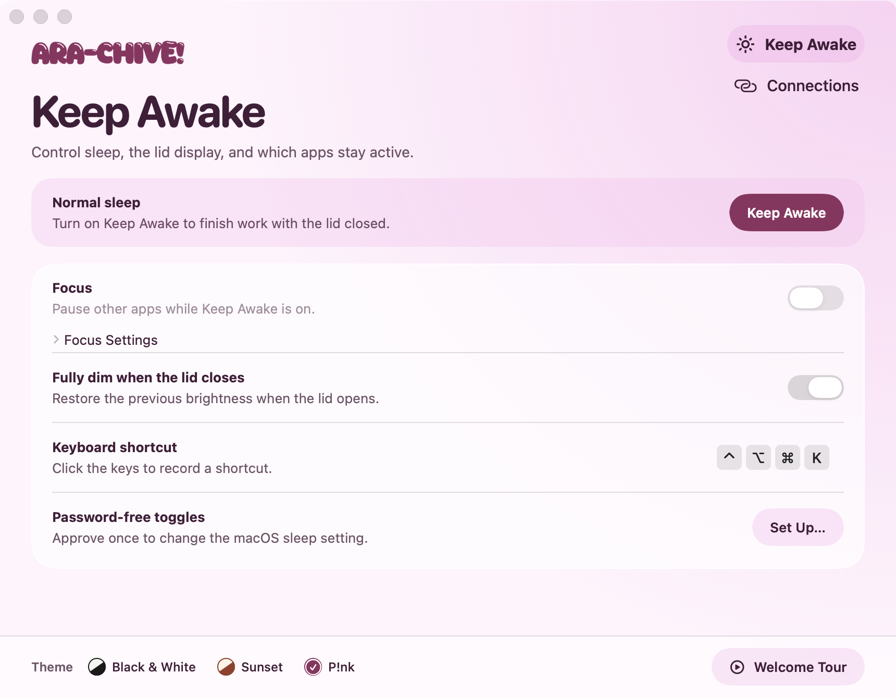
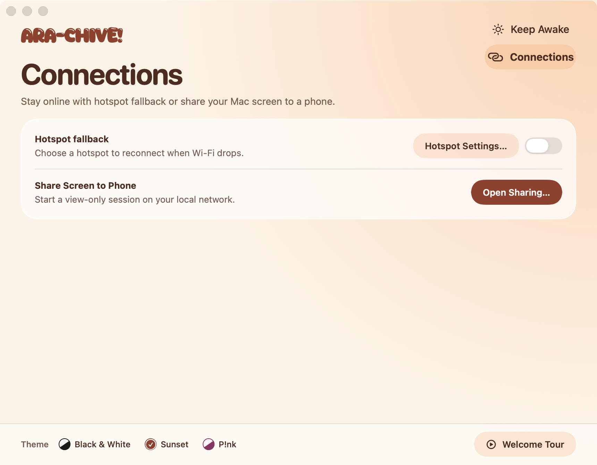

# Archaive

A native macOS app for pausing background apps during Focus, keeping your Mac awake, and reconnecting to your phone’s hotspot. Requires macOS 13 or later and Xcode Command Line Tools to build. Sparkle is bundled for app updates.

## Screenshots





## Install

Download the Apple Silicon DMG from [Releases](https://github.com/roxvi/arachive/releases), open it, and drag **Archaive** onto **Applications**. Eject the disk image, then open Archaive from Applications. The installer includes a large Finder window with the actual draggable icons and a connecting arrow.

Or install the same public release with Homebrew; no GitHub login or token is needed:

```sh
brew install --cask roxvi/tap/archaive
```

The app is ad-hoc signed, not Apple-notarized. If macOS blocks the first launch and you trust the source, use Apple's per-app **Open Anyway** approval in System Settings → Privacy & Security. Quit Archaive before upgrading so it can resume paused apps and restore sleep and brightness.

Archaive 1.6.0 and later automatically check for updates. Use **Check for Updates…** in the Archaive menu or from its menu-bar icon to check on demand. The update dialog lets you opt in to automatic installation. Update checks and downloads use public URLs and require no GitHub login.

The canonical repository is **roxvi/arachive**; the app name is **Archaive**. Source history from `summrs-private` has been merged here, and the original `summrs` release remains available.

## Build and run

```sh
./scripts/build.sh
open dist/Archaive.app
```

Move `dist/Archaive.app` to Applications if you want to keep it. Add it in System Settings > General > Login Items to launch at login. The local build is ad-hoc signed, not notarized for distribution.

To build the release installer on Apple Silicon:

```sh
./scripts/test.sh
python3 scripts/package-dmg.py
```

Packaging requires Python 3 and downloads pinned `dmgbuild` dependencies into an isolated `.build/dmg-venv`. It generates `dist/Archaive-<version>-arm64.dmg` and its SHA-256 file. Update `VERSION` before making a new installer; the packager refuses to overwrite existing installers. No packaging dependencies ship in the app.

To publish a Sparkle update, run `./scripts/sign-update.sh` after packaging on a Mac with the `roxvi.arachive` signing key in Keychain. Publish the DMG and checksum on the public GitHub release tagged `v<version>`, then copy the generated `dist/appcast.xml` to `updates/appcast.xml` and push it to `main`. The release asset and feed both carry signatures. Keep the private key in Keychain and regenerate the feed after any changes to it.

Closing the last Archaive window removes its Dock icon and leaves the app running in the menu bar. Choose **Open Archaive** there to bring back the window and Dock icon.

## Focus in Keep Awake

Open **Archaive** from the Dock or choose **Open Archaive** from the menu bar. In **Keep Awake**, open **Focus Settings** and check the apps you want to keep running. Use **Add Apps…** to select apps that are currently closed. Turn on the **Focus** switch to pause other apps whenever Keep Awake is on. Archaive remembers the switch, your selections, and the launch policy.

Focus pauses eligible unselected apps and their bundled helpers. It keeps recognizable descendants of selected apps running and leaves system services, recovery tools, and unbundled processes running. Paused apps can appear unresponsive until you allow them or end the session.

In **Focus Settings**, enable **Only when the lid is closed** to pause apps when you close the lid and resume them when you open it. Keep Awake stays on. If the lid sensor is unavailable, apps stay running in this mode.

Under **Apps opened during Focus**, choose **Keep running** (the default) or **Pause automatically**. The policy applies while Focus is active. Closing the window leaves Focus running. Choose **Allow Sleep** or turn off the **Focus** switch to resume what Archaive paused. **Turn Off Focus** in the menu bar also turns off the switch. Quitting also resumes those processes, and a separate helper resumes them if the window process is force quit or crashes.

## Keep Awake and hotspot

- Press **Control–Option–Command–K** to toggle keep awake. The sun menu icon means sleep is disabled; the moon means normal sleep. Click the key boxes during onboarding, or click the key boxes in the **Keep Awake** page, then press your preferred combination. The boxes show the keys as you press them; Escape cancels. Include Command, Option, or Control with a letter or number. Changes persist across launches; unavailable combinations keep your previous shortcut. Key names use the US keyboard layout. The window and menu bar also offer the toggle if another app owns the shortcut.
- Choose **Set Up…** under **Password-free toggles** in **Keep Awake** (or **Approve Once** in the tour). macOS requests administrator access to install a narrow, per-user permission rule. Subsequent toggles and normal quit restoration use `sudo -n` and never ask interactively. This is a system-wide setting, including lid-closed sleep; it is not merely an idle-sleep assertion. The app starts by reading the actual setting and never enables it automatically.
- With keep awake and **Fully Dim When Lid Closes** enabled, closing the lid sets supported displays to zero brightness. Opening the lid, disabling the option, or quitting restores the previous brightness. This does not issue display sleep, wake, logout, or screen-lock commands. It uses the lid switch, not hinge angle, and does not change keyboard backlight. Brightness control uses the private DisplayServices framework, resolved at runtime; unsupported monitors report an error instead of falling back to sleep. Other macOS idle/lock policies remain unchanged. After a force quit while dimmed, use the brightness keys if necessary.
- Connect to your hotspot once through macOS Wi-Fi settings so its password is saved. In **Connections**, choose **Hotspot Settings…**, enter its exact Wi-Fi name, and save. Emoji names and Command-V paste are supported; the Emoji & Symbols button opens Character Viewer. The Wi-Fi limit remains 32 UTF-8 bytes, not 32 visible characters. The phone must be nearby and broadcasting; Archaive cannot turn on a phone hotspot remotely.
- Hotspot fallback waits 12 seconds without a usable Wi-Fi path, then requests the saved network through `networksetup`. Retries are at least 45 seconds apart. It does not enable a manually disabled Wi-Fi radio or replace an active Wi-Fi path. It is not an internet outage/captive portal detector. macOS credential or administrator restrictions can prevent joining; reconnect manually in Wi-Fi settings if needed.

In **Hotspot Settings…**, enable **Use Custom Password** to enter a password directly. It is stored as an app-specific Keychain item for that exact Wi-Fi name. Leave the field blank to reuse the stored custom password for that name. With the toggle off, Archaive omits the password and uses macOS’s saved credentials. Custom passwords are passed to `networksetup` through standard input, never command-line arguments or UserDefaults. A successful join may update macOS’s saved Wi-Fi password as well.

## Share your Mac screen to your phone

In **Connections**, choose **Open Sharing…**, then **Start Sharing**. Approve macOS Screen Recording permission (and Local Network access if requested). Connect your phone and Mac to the same Wi-Fi or phone hotspot, then open the native **Archaive iPhone app** and tap **Scan QR Code**. You can also copy the session link or open one of the displayed addresses in Safari/Chrome. If macOS requires a relaunch after granting capture permission, quit normally and reopen Archaive.

The native iPhone companion requires iOS 17 or later and supports QR pairing, paste-link fallback, pinch-to-zoom, landscape viewing, and connection recovery. See [iPhone build and installation](iOS/README.md); it currently requires building and signing in Xcode and is not published on the App Store or TestFlight. It pauses capture requests and hides the image when backgrounded. A browser viewer remains available for iPhone and Android; scan the QR with the system camera to open that fallback. Links belong to the current sharing session, so scan a fresh link after restarting sharing. The viewer fits the display by default; **Actual size** lets you scroll around the captured image. Sharing is view-only, without audio, keyboard, or touch control, at up to 10 frames per second and 1280 pixels wide.

**Fully Dim When Lid Closes** continues to dim the physical Mac display. Sharing captures the desktop through ScreenCaptureKit before panel brightness, so the phone image retains its normal brightness. Phone brightness remains under your phone’s control. For closed-lid use, enable keep awake first. macOS must still expose an active display; this does not create a virtual monitor, bypass a locked screen, or prevent macOS from removing a display. If capture is unavailable, the viewer hides the image and reports the connection problem.

Sharing starts only on request. Anyone holding the random session link can view the screen over an **unencrypted local HTTP connection**: use a trusted network. No cloud relay or account is involved. **Stop Phone Sharing**, locking/switching away from the Mac session, or quitting ends sharing and invalidates the link. Closing the setup window leaves an active share running, with a stop action in the menu. If a link fails, try another displayed address, check Local Network/firewall permissions, and check whether the Wi-Fi/hotspot isolates devices. Restart sharing after changing networks.

Automated checks cover session routing, expired/wrong links, local iPhone pairing-address validation, and existing brightness restoration. Screen Recording approval, phone connectivity, QR scanning, and capture with the lid closed and panel at zero brightness require a live hardware check.

## Restoring sleep

Quit restores the sleep setting that existed before Archaive changed it. If setup is missing or restoration fails, the app stays open so you can retry. Force Quit, a crash, or a power loss can leave this system-wide setting enabled. On the next launch, Archaive offers **Restore** under **Previous sleep setting** in **Keep Awake**. To re-enable sleep manually:

```sh
sudo pmset -a disablesleep 0
```

An awake Mac still consumes battery and produces heat with the lid closed. Do not put it in a bag while keep awake is enabled.

## Verification

```sh
./scripts/test.sh
```

The standalone harness runs with Command Line Tools, without requiring Xcode/XCTest. Tests cover the Keep Awake and Focus lifecycle, Focus policy, process pause and resume, recovery when the helper loses its connection, power-state parsing, reconnect grace periods, retry backoff, recovery after Wi-Fi returns, disabled/unconfigured states, emoji argument preservation and SSID validation, and brightness restoration including failed writes. Hardware acceptance requires checking the shortcut, approving the macOS authorization dialog, closing/reopening the lid, and losing Wi-Fi near a configured hotspot. Building and unit tests do not establish those hardware behaviors.

Implementation references: [Apple's pmset source](https://github.com/apple-oss-distributions/PowerManagement/blob/main/pmset/pmset.m), [Core WLAN](https://developer.apple.com/documentation/corewlan), and the installed `networksetup -help` documentation.

Brightness API reference: [Hammerspoon brightness implementation](https://github.com/Hammerspoon/hammerspoon/blob/master/extensions/brightness/libbrightness.m).

## Welcome tour

First launch opens a five-step desktop takeover: menu reveal, safe shortcut practice, a lid-dimming simulation, optional real hotspot setup, and a menu-bar introduction with arrows pointing toward the actual icon. The tour hands off to the Archaive window. **Welcome Tour** in the main window opens it again without resetting your settings. Skip or Escape dismisses it and records completion. Continue never requires a demo interaction or hotspot setup.

During the tour, the global shortcut only changes the isolated preview on its practice step; it never changes the system sleep setting. The practice slide morphs between moon and sun without changing the system. The fixed moon and sun buttons on the final step select the Mac’s actual normal-sleep and keep-awake modes, with the confirmed mode highlighted. Administrator setup is offered if needed. Hotspot setup opens the real settings window above the tour. Closing settings preserves the previous configuration and permits retry/skip. Save errors remain in the settings window; successful save enables automatic fallback and returns to the tour.

The overlay follows Spaces on the chosen display without creating a fullscreen Space. Steps slide horizontally on a shared track over 0.7 seconds without fading. Reduced Motion switches pages immediately. On small displays, content stacks and scrolls while navigation stays reachable. If the status icon cannot be located, the finale provides a reveal-menu-bar hint instead of pointing at an invented location.

Onboarding state tests cover navigation boundaries, Back direction, demo isolation, and setup/finish callbacks. Native visual layout, VoiceOver/keyboard traversal, Spaces, first-launch persistence, and actual setup/handoff still require runtime verification.

## One-time administrator setup

**Approve Once** in the shortcut-practice step installs `/private/etc/sudoers.d/archaive-<your numeric user ID>`. It grants that macOS user password-free execution of exactly `/usr/bin/pmset -a disablesleep 0` and `/usr/bin/pmset -a disablesleep 1`. Other processes running as that user can also invoke those two commands. It does not grant general sudo access, install a daemon, or store an administrator password. The rule is owned by root:wheel with mode 0440, and persists across app restarts and builds.

The installer checks the existing sudoers configuration, validates the new rule with `visudo`, refuses to overwrite differing rules, and rolls back a new file if final validation fails. Macs without the standard sudoers.d include receive an error; Archaive does not rewrite the main sudoers file. Setup itself does not toggle sleep. If setup is skipped/cancelled, the first real toggle offers setup again; after setup, press the shortcut again to toggle.

**Remove Access…** in **Keep Awake** removes only this user's Archaive rule, with administrator approval. First restore the previous sleep setting and turn keep awake off. Removing the app alone does not remove the permission. If macOS or an administrator removes/overrides the rule later, Archaive reports an error rather than falling back to repeated password dialogs.

Regression tests validate the exact rule using the installed `visudo`, installer shell syntax, and shell/AppleScript escaping without installing anything. Actual administrator approval, installation/removal, and password-free toggles require a live authorized setup check. Rule semantics: [sudoers manual](https://www.sudo.ws/docs/man/1.9.14/sudoers.man.pdf).
